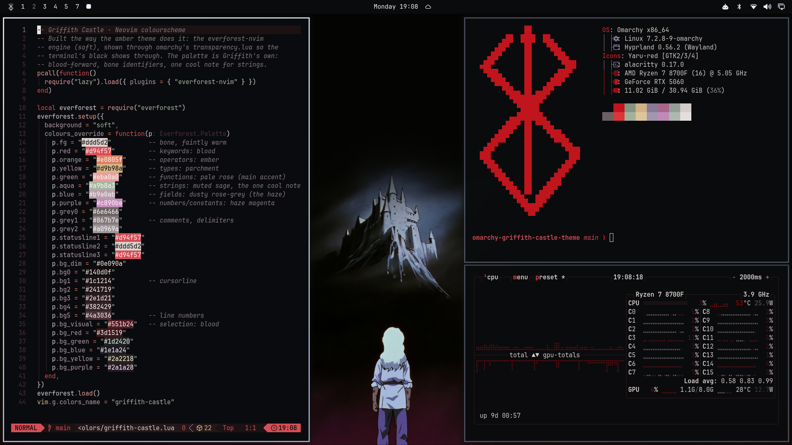
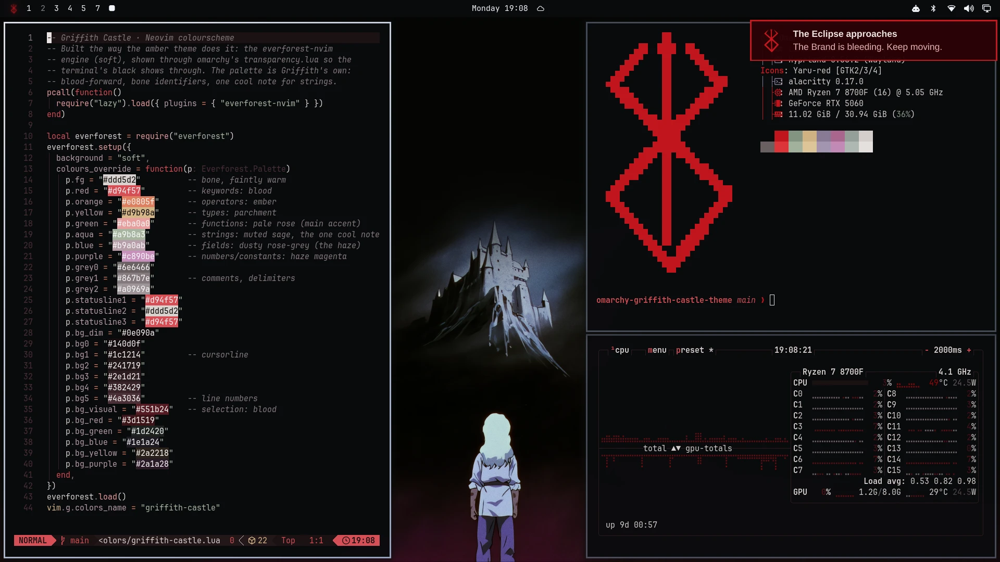
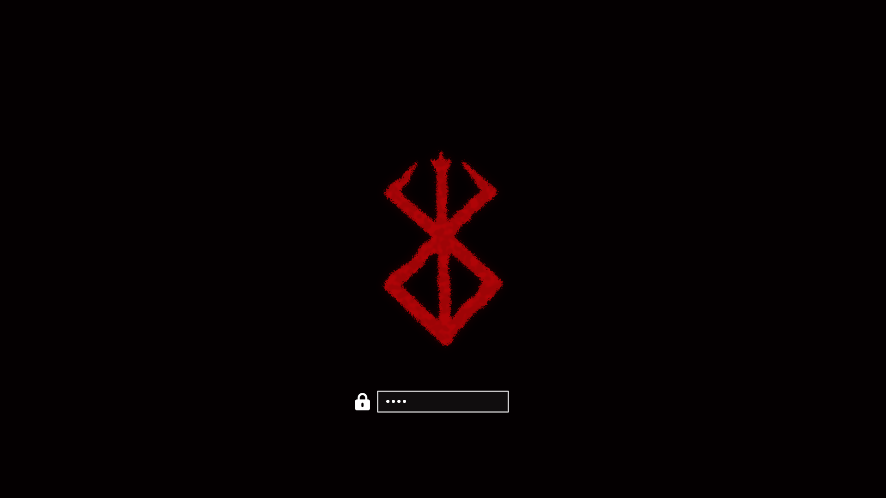

# Griffith Castle

An [Omarchy](https://omarchy.org) theme after one frame of *Berserk* (1997), episode 24: the boy Griffith looking up at the castle he will sacrifice everything for.



## The idea: the dream and its price

The frame is almost all film black and cold moonlight. The castle's glow is the dream, so the desktop chrome stays cold: bone-to-steel window borders, a black bar, quiet cards. The red came from the Brand of Sacrifice, so it marks the price: the terminal and editor accents, the selection, and every place where something is wrong.

- **Critical notifications** turn into a blood card, and the Brand in the bar starts to bleed (in the manga it bleeds when demons are near).
- **Lock and boot** show only the Brand, broken like spray paint, in `#A10203` on black, with a plain white field.





*The boot screen above is rendered with `omarchy plymouth preview` from the theme's own assets; the two desktop shots are live captures.*

## Palette

| | | |
|---|---|---|
| void `#050607` · bg `#0a0b0e` | moonlight `#eef2f9` → `#a2b0ce` | bone `#ddd5d2` |
| blood `#a10203` · bright `#c8161d` | rose `#d94f57` · ember `#e5383b` | dried blood `#551b24` |

The haze hue (about 335°) and the moonlight were measured from the Blu-ray frame; the reds come from the Brand.

## What's in the theme

| File | |
|---|---|
| `colors.toml` | Terminal palette: blood-forward, with ANSI blue and cyan pulled toward grey-violet and grey-sage |
| `hyprland.lua` | Square corners, 2px 45° moonlight gradient border, gaps 4/8, deep shadow, calm decel animations |
| `shell.toml` | Bar, menus, launcher and notifications with 1px gradient borders and blood selections; the white lock field; a `[motif]` section (see extras) |
| `neovim.lua` + `nvim/colors/griffith-castle.lua` | Own colourscheme on the everforest-nvim engine (soft, transparent): pale-rose functions, blood keywords, ember operators, parchment types, haze-magenta numbers, sage strings |
| `btop.theme` | Graphs rising from dried blood through `#a10203` to ember |
| `fastfetch-logo.txt` | The Brand as half-block art |
| `vhs.frag` | Optional 1997 broadcast shader: grain, edge fringe, faint scanlines, vignette |
| `backgrounds/` | `1-` the castle up close (Blu-ray frame, 2× upscaled), `2-` the original composition floating in the void |
| `unlock.png`, `motif/` | The broken Brand for boot and lock, plus the bar icons |

## Install

```bash
omarchy theme install https://github.com/JonathanLauener/omarchy-griffith-castle-theme
omarchy theme set griffith-castle
```

A theme installed from a repo may not ship Lua, so Omarchy regenerates `hyprland.lua` and `neovim.lua` from `colors.toml`. For the exact window chrome and the editor colourscheme, copy those two files (and `nvim/`) into `~/.config/omarchy/themes/griffith-castle/` yourself, and remove the theme's `.git` folder once you no longer need updates.

### Extras (optional)

```bash
~/.config/omarchy/themes/griffith-castle/extras/install.sh
omarchy restart shell
```

- Patches cloned copies of three shell plugins: `menu` puts the Brand in the bar and makes it bleed while a critical notification is up, `notifications` styles critical cards, and `lock` shows the Brand screen. The patches only switch on when the current theme has a `[motif]` section, so every other theme looks stock.
- Installs the `theme-motif` theme-set hook. It links the nvim colourscheme, writes a fastfetch config with the Brand logo and red keys, and switches the starship palette. All three are reverted for themes that don't ship them.
- Installs `griffith-vhs`, which toggles the shader. Bind it yourself, for example to `SUPER + CTRL + ALT + V`.
- Red prompt: merge `extras/starship/palettes.toml` into `~/.config/starship.toml`.
- Boot screen: `omarchy plymouth set by theme griffith-castle`

## Credits

*Berserk* © Kentaro Miura / Hakusensha. The wallpapers are a frame from the 1997 TV series (OLM / VAP) and the Brand of Sacrifice is Miura's design; both are included for personal use only and are not covered by the license below. The everforest-nvim engine is by [neanias](https://github.com/neanias/everforest-nvim), the window chrome follows the amber theme, and the shell patches modify [Omarchy](https://github.com/basecamp/omarchy) code (MIT).

The theme's own code and configuration are MIT licensed. See `LICENSE`.
